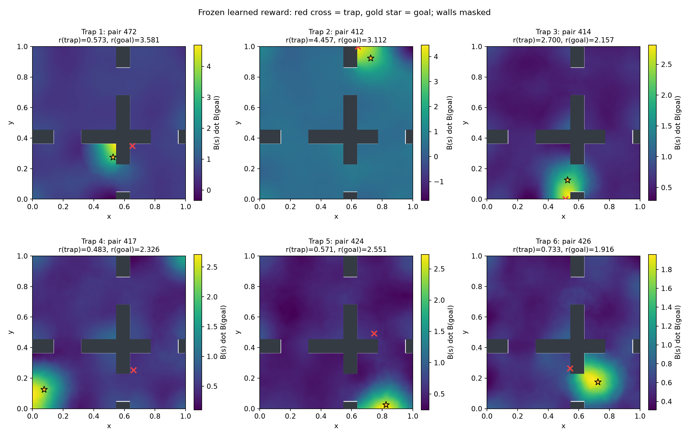
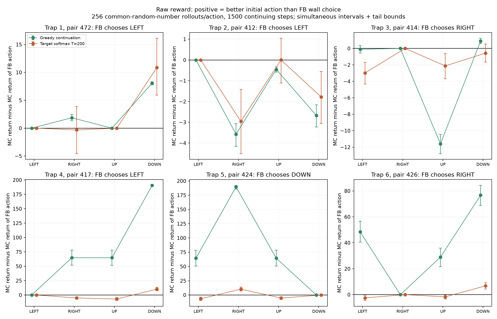
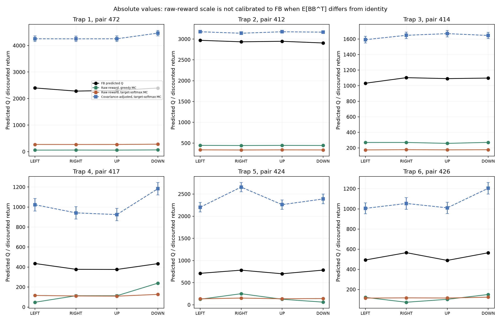
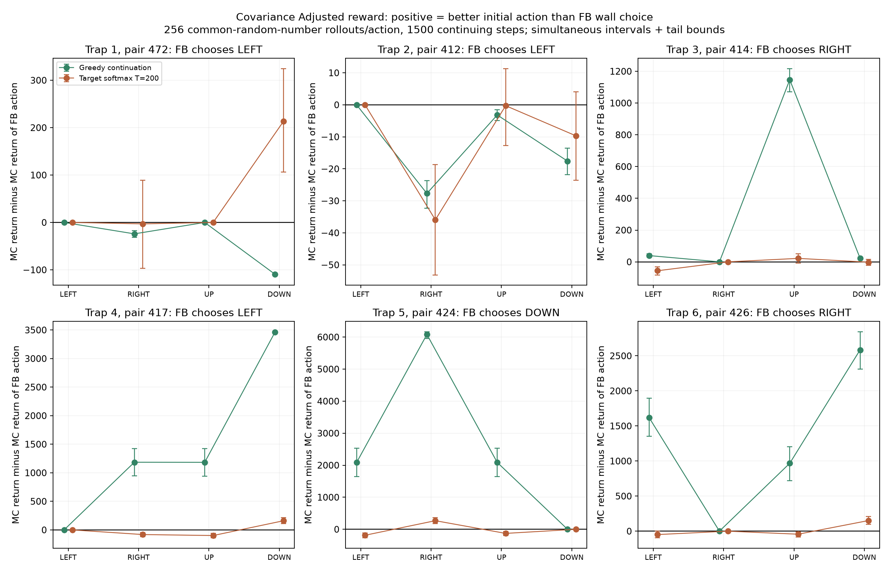

# Learned reward versus inaccurate values at recorded wall traps

Frozen epoch-800 width-2 replay-continuing model trained with goal threshold 0.025. Six different goal pairs, starting with the previous recorded example, then distinct failed goal pairs nearest an 80-step stationary collision run. Each anchor is a recorded collision position where the current greedy action is nominally blocked. These are selected cases, not prevalence estimates.

## Findings

**Both mechanisms occur in these selected cases.** Moving away beats FB's blocked initial action under the literal training-backup continuation in traps [1, 4, 5, 6]; these same four cases remain significant with the covariance-adjusted reward (traps [1, 4, 5, 6]). This supports inaccurate action rankings rather than a raw-reward scaling artifact in those cases. Traps [2, 3] have raw reward at the trapped position greater than reward at the goal. In both, a controller that reaches the goal in every rollout has lower raw discounted return than the trapped greedy policy.

For example, trap 4 (pair 417) predicts LEFT=435.47 versus DOWN=434.08, but the target-softmax MC returns are LEFT=116.07 versus DOWN=126.45 for the raw reward. DOWN gains 10.38 (simultaneous interval including the tail bound: 7.37 to 13.49). The covariance-adjusted DOWN advantage is 160.12 (108.02 to 215.37), retaining the contradiction.

Trap 2 (pair 412) instead has raw r(trap)=4.457 versus r(goal)=3.112. The trapped greedy return is 445.70; the verified goal detour returns 312.43. Its covariance-adjusted instantaneous reward also favors the trap (41.99 versus 32.34). Trap 3 has a raw-reward false peak too, but its covariance-adjusted immediate reward favors the goal (16.55 versus 31.65), and its target-policy MC ranking is unresolved for that adjusted reward. It should not be assigned the same confident diagnosis as trap 2.

These six deliberately selected examples do not estimate how often each mechanism occurs across all failures.

## Return convention

`G_H = sum(t=0..1499) gamma^t * B(s_t)^T B(goal)`, gamma=0.99. Force each of LEFT/RIGHT/UP/DOWN at t=0; use 256 matched noise/continuation streams per action. Online B is frozen; rewards are neither normalized nor clipped. Movement is native and noisy. Do not stop, freeze, reset, or zero rewards on goal entry. The environment success threshold is used only to record auxiliary goal hits. No entropy bonus is added to returns.

The local loss uses the current observation in `-mean(F(s,a,z) dot B(s))`, so current-state reward timing is used. The primary policies are greedy and the literal frozen target-F softmax(Q/200) used by the training backup. Online softmax(Q/200), wall-masked greedy, and an external geometry-only detour controller are additional diagnostics. All comparisons use the original online policy task z=B(goal).

Four analytic tests passed: current-state timing/forced first action, continuing after goal entry, rejected moves, and all three continuation selectors. Conservative global network interval bounds limit omitted return tails; see covariance_audit.json. Return checkpoints at 150, 500, 1000 and 1500 steps are retained. Intervals use paired bootstrap samples, a Bonferroni correction across the three alternatives to the FB action, and twice the remaining-tail bound for action differences.

## Raw reward and action rankings

| Trap / goal pair | FB choice | r(trap) | r(goal) | Greedy-MC best first action | Target-softmax-MC best first action |
|---|---|---:|---:|---|---|
| 1 / 472 | LEFT | 0.573 | 3.581 | DOWN | DOWN |
| 2 / 412 | LEFT | 4.457 | 3.112 | LEFT | UP |
| 3 / 414 | RIGHT | 2.700 | 2.157 | DOWN | RIGHT |
| 4 / 417 | LEFT | 0.483 | 2.326 | DOWN | DOWN |
| 5 / 424 | DOWN | 0.571 | 2.551 | RIGHT | RIGHT |
| 6 / 426 | RIGHT | 0.733 | 1.916 | DOWN | DOWN |

Best actions are point estimates; use action_comparisons.json for uncertainty and which genuinely moving first actions beat the blocked choice. Boundary-clipped actions with zero nominal displacement are not classified as detours.





## Verified multi-step goal detours

A one-step intervention can return to the same trap under greedy continuation. To test longer detours, an external controller follows a geometry-only BFS distance field, using native noisy movement and all four original actions. It continues moving near the goal after entry. This controller is diagnostic only and changes neither FB nor training. Its goal-hit rates verify whether the tested routes actually reach the goal.

| Trap | Raw return: forced FB action then greedy | Raw return: forced FB action then goal detour | Detour goal-hit rate |
|---|---:|---:|---:|
| 1 | 57.31 | 323.42 | 100.0% |
| 2 | 445.70 | 312.43 | 100.0% |
| 3 | 270.19 | 213.16 | 100.0% |
| 4 | 48.30 | 203.86 | 100.0% |
| 5 | 61.59 | 234.86 | 100.0% |
| 6 | 73.32 | 180.76 | 100.0% |

## Covariance qualification for comparing Q to this reward

The empirical uncentered replay covariance C=E[B(s)B(s)^T] is far from identity. Its mean eigenvalue is 0.06537, eigenvalues range from 0.01330 to 0.64118, and ||C-I||_F/sqrt(d)=0.939. Thus raw B(s)^T B(goal) returns and F(s,a,B(goal))^T B(goal) need not have the same scale or rankings.

With frozen shared B and an exactly solved projected FB equation, the F normal equation is `C F = B(s) + gamma C E[F_next]`. Consequently the corresponding scalar immediate reward is `B(s)^T C^{-1} z`, which reduces to `B(s)^T z` only when C=I (on the relevant subspace). This is an inference from the implemented loss, not an extra reward used in training. We therefore also score each identical trajectory with `B(s)^T pinv(C) B(goal)`. C is estimated from 32,768 final-replay observations; rcond=1e-6. This secondary diagnostic has covariance estimation uncertainty not covered by the trajectory confidence intervals.





## Interpretation limits

A significantly better moving initial action under the backup policy, especially when it remains better for the covariance-adjusted reward, is evidence of inaccurate learned action rankings. A wall trap with greater raw reward than the goal, and a verified goal-reaching detour with lower raw return, is evidence of a problematic raw goal-reward landscape. Both mechanisms can coexist. Greedy first-action agreement alone does not prove the wall is globally optimal, and an absolute raw-return/Q mismatch alone does not prove a value error when C differs from identity. Training uses target networks and a changing representation; the frozen projected equation is an approximation for diagnosing the trained model, not a guarantee of its calibration.

## Files and reproducibility

`q_and_mc_returns.csv` contains every action, continuation, reward, Q prediction, MC mean/SE, paired difference interval, first collision rate and auxiliary goal-hit rate. `surrounding_rewards.csv` and the reward maps record nearby free states. All trajectories, checkpoint hashes and sampling settings are retained in the NPZ/JSON files. Run these from the repository root:

```bash
python experiments/maintenance/diagnose_implicit_reward_traps_20261106.py --device cpu
python experiments/maintenance/geometry_detour_implicit_reward_20261106.py
python experiments/maintenance/summarize_implicit_reward_traps_20261106.py
python -m unittest tests.test_reward_diagnostics -v
```

No changes were made to training, learned parameters, checkpoints, or environment dynamics.
