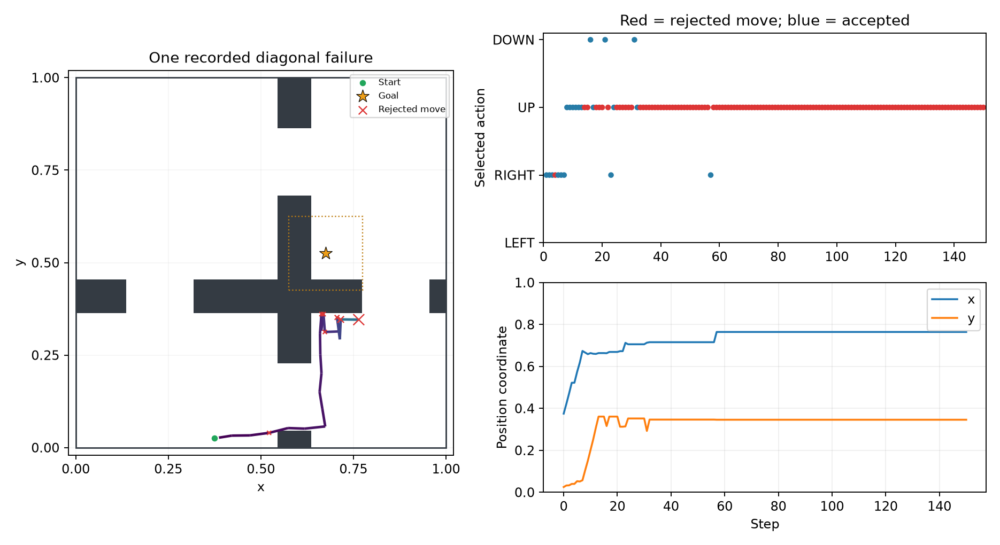
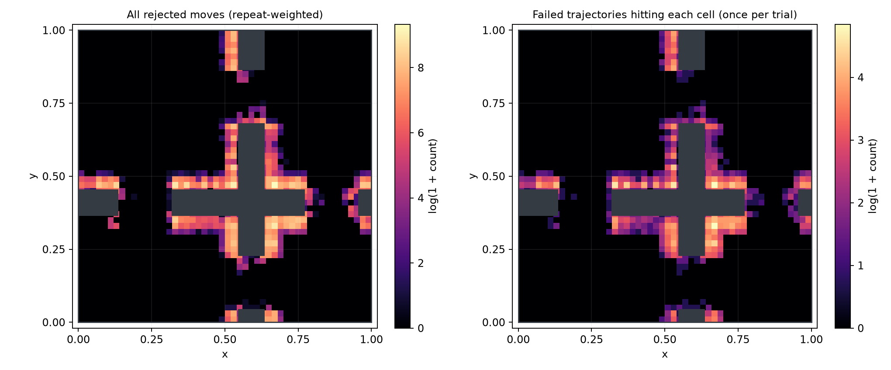
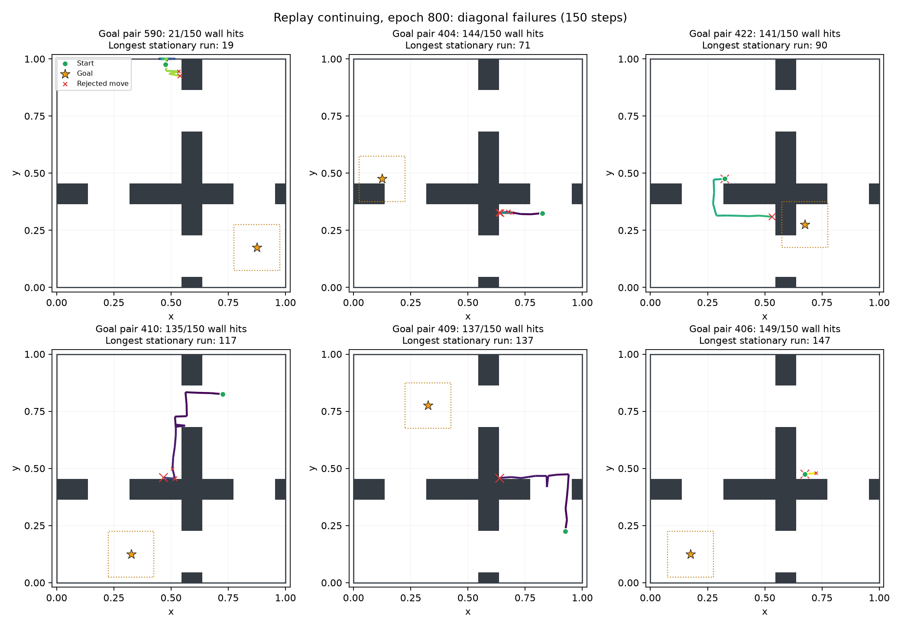

# Diagonal wall traps: replay-continuing FB, epoch 800

Repeated attempts to move through a wall are common in this checkpoint's failed
diagonal navigation. Individual trajectories often remain at exactly the same
position for many steps. Across different goals these traps occur along several
wall faces and doorway edges, rather than one shared coordinate.

## Sample and protocol

- Run: `runs/width2_replay_continuing_seed0`, checkpoint `epoch_0800.pkl`.
- This is replay-goal task sampling with the unchanged **continuing** objective,
  not the older replay-stopped run or the original Cauchy run.
- Checkpoint SHA-256:
  `04fde123ba3ad5be8ac417b4589311c11d45ba9140297260f53d63ae1b85376f`.
- 200 diagonal start-goal pairs from the existing independent comparison,
  32 stochastic rollouts per pair: 6,400 trajectories total. These repetitions
  share one training seed and are not independent trained models.
- Online F and B, `z=B(goal)`, epsilon 0.02; original width-2 dynamics and
  coordinate-wise goal tolerance 0.1. Stop upon success. Record up to 150 steps
  and also compute the 30-step result from the same trajectories.
- Trial keys: `fold_in(PRNGKey(20261108), global_pair_index * 32 + replica)`.
- Every recorded success time exactly matches the earlier saved Monte Carlo
  evaluation. Every rejected wall move was checked to leave position unchanged.

## How common is repeatedly hitting the same place?

All percentages below are **among failures at the indicated horizon**.

| Measurement | 30 steps | 150 steps |
|---|---:|---:|
| Failed rollouts / all 6,400 | 4,043 | 2,855 |
| Any rejected wall move | 89.46% | 91.52% |
| At least 10 consecutive rejected moves at one exact position | 83.48% | 90.12% |
| At least 10 consecutive repeats of the same rejected action | 83.16% | 90.12% |
| Median longest consecutive stationary wall-hit run | 19 steps | 90 steps |
| At least 80% of wall hits within radius 0.02 of the primary collision position | 77.84% | 58.56% |
| Fraction of all actions rejected by walls | 64.32% | 83.02% |

The primary collision position is the most frequently visited exact collision
coordinate; the radius statistic uses Euclidean distance only to measure spatial
clustering, not to detect goal success. No-collision failures count as false in
the 80% row. Some long rollouts escape one trap and encounter another, so the
single-neighborhood statistic falls at 150 steps even though long wall-hit runs
remain very common.

These observations support wall trapping as a frequent mechanism of failure.
They do not by themselves establish why the learned action values prefer the
blocked action. At 150 steps, 242 failures have no rejected wall moves at all.

## Recorded example

Global goal-pair index 596, replica 2 (diagonal-subset trial 6274) starts at the
bottom left, crosses the first doorway into the bottom-right room, and becomes
stuck below the horizontal wall while attempting UP towards the top-right goal.

- 130 of 150 actions are rejected by walls.
- Steps 58 through 150 are **93 consecutive UP actions**, all rejected at the
  exact position `(0.7643932, 0.3458839)`.
- Goal center: `(0.675, 0.525)`.
- At this final position, Q values are approximately LEFT 3632.28, RIGHT 3728.51,
  UP 3845.05, DOWN 3547.20. The blocked UP action remains the greedy choice.
- The example was selected at the median longest stationary wall-hit run among
  150-step failures with at least one completed room crossing and a run of at
  least 10 rejected moves; it is an illustrative conditional example.



[Animated recording](recorded_failure.gif) · [Per-step coordinates, actions and Q values](recorded_trajectory.csv)

## Two additional recorded failures

Both examples use the same checkpoint, epsilon, 150-step horizon and existing
verified trajectory cache, with different start-goal pairs from the first example.

- **Pair 409, replica 0 (trial 288):** starts at the bottom right, crosses the
  right-hand doorway into the top-right room, and gets stuck attempting LEFT
  through the vertical wall. 139 wall hits; 138 consecutive rejected LEFT
  actions at one exact position.
  [Figure](recorded_failure_pair0409_rep00.png),
  [animation](recorded_failure_pair0409_rep00.gif),
  [per-step data](recorded_failure_pair0409_rep00.csv).
- **Pair 410, replica 0 (trial 320):** starts at the top right, crosses into the
  top-left room, and repeatedly attempts DOWN through the horizontal wall.
  Occasional moves change the collision location, but do not reach the goal.
  135 wall hits; longest consecutive stationary wall-hit run 74 steps.
  [Figure](recorded_failure_pair0410_rep00.png),
  [animation](recorded_failure_pair0410_rep00.gif),
  [per-step data](recorded_failure_pair0410_rep00.csv).

These illustrative examples were selected from different goal pairs visible in
the failure gallery. Their individual JSON files retain checkpoint hashes,
start and goal coordinates, trial indices, and collision metrics. Reproduce
without replacing the original figure:

```bash
python experiments/maintenance/record_replay_failures_20261106.py --example-trials 288 320
```

## Where collisions occur

The left map pools all rejected moves and therefore gives substantial weight to
long stationary runs. The right map counts each failed trajectory at most once
per 0.02-by-0.02 cell, distinguishing repeatedly hitting one location from many
trajectories encountering the same location. Both show traps across multiple
wall faces and doorway edges. Color scales use `log(1 + count)`.



The gallery shows six different goal pairs near the 10th, 30th, 50th, 70th,
85th and 95th percentiles of failed trajectories' longest stationary wall-hit
run. Paths use time color progression; green circles are starts, gold stars are
goals, dotted squares show success regions, and red crosses mark rejected moves.



## Reproduce

From the repository root, with the existing comparison pairs and checkpoint:

```bash
python experiments/maintenance/record_replay_failures_20261106.py --device cpu
```

Outputs stay in this folder. `traces.npz` contains all recorded states, next
states, actions, Q values, active flags, collision flags and goal-hit times.
`metrics_30.json`, `metrics_150.json`, and `summary.json` contain the numerical
results. The cached trajectories are checked against the checkpoint hash and
the earlier evaluation's exact success times. Synthetic checks also passed for
stationary run lengths, changing actions, collision clustering and trajectories
with no collisions. No training or checkpoint changes were made.
