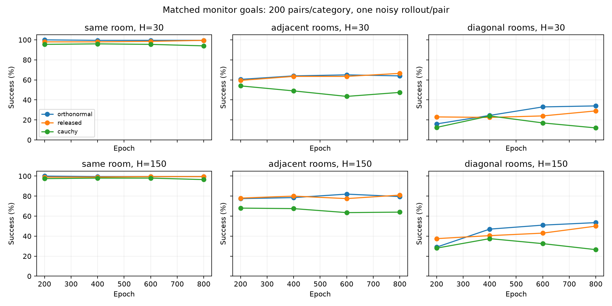

# Replay continuing: orthonormal versus released B regularization

The orthonormal run completed 800 epochs / 800,000 updates / 2.4 million transitions. All 800,000 stored losses are finite. It modestly improves final diagonal success on the saved monitor, but does not establish an overall navigation improvement over replay with the released regularizer.

## Protocol and validation

This analysis reads saved artifacts only; no training or policy rollouts were rerun. All three runs have identical endpoint arrays, category assignments, BFS lengths and rollout seed. There are 200 pairs per category and one noisy rollout per pair: online F/B, epsilon 0.02, coordinate-wise goal tolerance 0.1, doubled doorways, horizons 30 and 150. These are the training monitor endpoints (seed 271828), not the different endpoints used in the older 32-rollout reports.

The two replay configurations differ only in b_regularization: orthonormal versus touati_continuous. Both use replay goals, the continuing objective, coefficient 1, training seed 0 and identical recorded Python/JAX/NumPy versions. Archived source hashes were verified. Learner source is byte-identical; AST comparisons confirm unchanged rollout/evaluation, movement, environment classes and compiled epoch function. Other archived changes include package import relocation, shared geometry/plotting helpers, threshold validation with the same default 0.1, and source archival paths. This is not a byte-identical whole-repository comparison.

## Final checkpoint

| Category | Horizon | Released replay | Orthonormal replay | Change (pp) | Paired 95% interval (pp) | Gained / lost pairs |
| --- | ---: | ---: | ---: | ---: | --- | --- |
| same_room | 30 | 99.5% | 99.5% | +0.0 | [-1.5, +1.5] | 1 / 1 |
| adjacent_rooms | 30 | 66.5% | 64.0% | -2.5 | [-8.0, +3.5] | 15 / 20 |
| diagonal_rooms | 30 | 29.0% | 34.0% | +5.0 | [-2.0, +12.0] | 32 / 22 |
| same_room | 150 | 99.5% | 99.5% | +0.0 | [-1.5, +1.5] | 1 / 1 |
| adjacent_rooms | 150 | 81.0% | 79.5% | -1.5 | [-6.5, +3.5] | 12 / 15 |
| diagonal_rooms | 150 | 50.0% | 53.5% | +3.5 | [-4.5, +11.5] | 36 / 29 |

Intervals use 20,000 paired resamples of endpoint pairs. They describe uncertainty across these task/noise realizations, not training seeds. All six replay-versus-replay intervals include zero. The horizons share rollout randomness and should not be treated as independent replications.

## Learning curves and wall collisions

| Epoch | Orthonormal diagonal H=30 | Released diagonal H=30 | Orthonormal diagonal H=150 | Released diagonal H=150 |
| --- | ---: | ---: | ---: | ---: |
| 200 | 16.0% | 23.0% | 29.0% | 37.5% |
| 400 | 24.5% | 22.5% | 47.0% | 40.5% |
| 600 | 33.0% | 24.0% | 51.0% | 43.0% |
| 800 | 34.0% | 29.0% | 53.5% | 50.0% |

The orthonormal diagonal monitor improves from epoch 400 to 800 at both horizons, with no observed late diagonal deterioration at the saved checkpoints. It initially trails the released regularizer at epoch 200. Adjacent success peaks at epoch 600 (65% / 82%) and falls to 64% / 79.5% at epoch 800. Epoch 800 is the final comparison; no checkpoint was retrospectively selected.

| Category | Horizon | Released wall actions | Orthonormal wall actions |
| --- | ---: | ---: | ---: |
| adjacent_rooms | 30 | 44.32% | 46.01% |
| diagonal_rooms | 30 | 49.78% | 48.18% |
| adjacent_rooms | 150 | 74.14% | 72.86% |
| diagonal_rooms | 150 | 76.83% | 75.31% |

Wall-action percentages pool executed actions, not failed trials. The small diagonal collision reductions do not resolve wall trapping: 75.31% of diagonal H=150 actions are wall-rejected and 46.5% of diagonal trials fail. Saved aggregates do not identify repeated stationary collision streaks or establish the cause of failure.

## Interpretation

- Relative to released replay: diagonal success increases by 5.0 pp / 3.5 pp, adjacent success decreases by 2.5 pp / 1.5 pp, and same-room success is unchanged at 99.5% / 99.5%. Equal-category overall success rises by only 0.83 pp / 0.67 pp.
- Relative to Cauchy continuing: diagonal success rises from 12% / 26.5% to 34% / 53.5%. This contrast changes both task sampling and regularization, so it cannot isolate the orthonormality effect.
- Losses are finite but total loss values across the two regularizers are different objectives; their magnitudes cannot rank navigation quality. No feature-covariance diagnostic was run, so selecting orthonormal does not demonstrate that learned features are empirically orthonormal.
- The supported conclusion is a modest diagonal point-estimate gain in one training seed, with mixed results across categories. A matched repeated-rollout evaluation would test rollout robustness; additional training seeds are needed to establish a reliable regularizer benefit.



Reproduce artifact analysis from the repository root:

```bash
python experiments/fourrooms_doorways/analyses/replay_orthonormal_comparison/analyse.py
```

Machine-readable validation and comparisons: [results.json](results.json).

New run: `runs/width2_replay_continuing_orthonormal_seed0_20261109_084240/`.
