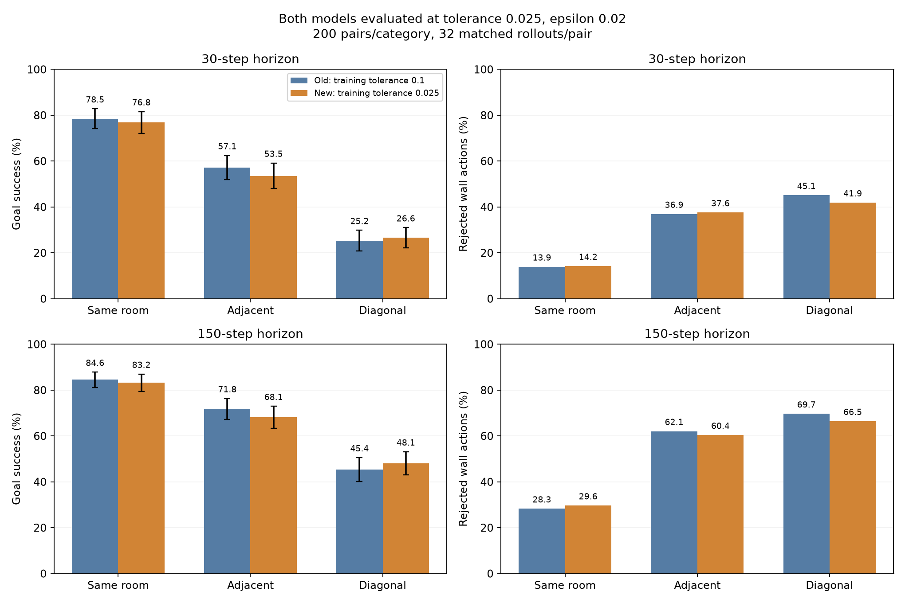
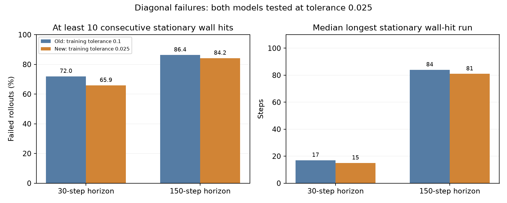
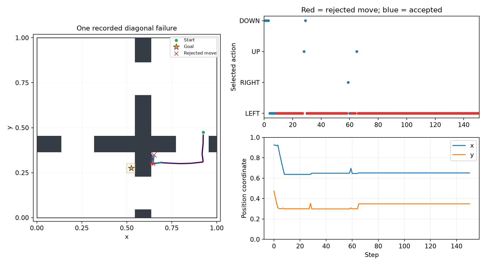
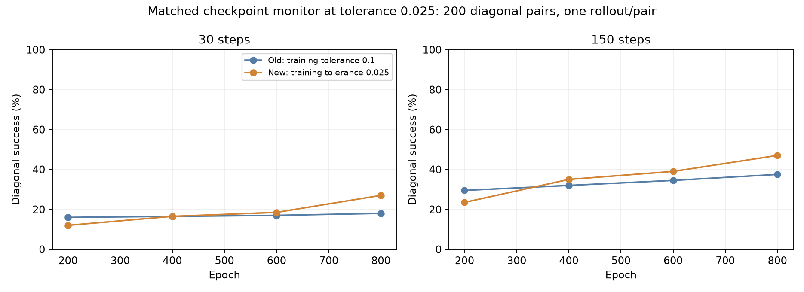

# Smaller-threshold experiment: matched comparison

Both 800-epoch models were evaluated at coordinate-wise tolerance **0.025**, online F/B, z=B(goal), epsilon 0.02, 200 start-goal pairs per category and 32 matched stochastic rollouts per pair. One training seed (0) per condition. All 800,000 losses are finite in each run; learner and RBF settings match, geometry/actions/noise match, and both collected 2.4 million transitions. Archived source files match except the adjustable environment parameter that exposes goal tolerance. See validation.json for checkpoint hashes and source parity.

The new model modestly improves diagonal point estimates and reduces diagonal wall actions. Same-room and adjacent-room goal success decrease, so goal reaching does not improve overall. Repeated wall trapping remains common.

| Horizon | Task | Old success | New success | New - old (pp; paired 95% interval) | Old wall actions | New wall actions |
|---|---|---:|---:|---:|---:|---:|
| 30 | same_room | 78.47% | 76.81% | -1.66 [-3.88, +0.55] | 13.93% | 14.18% |
| 30 | adjacent_rooms | 57.12% | 53.50% | -3.62 [-7.47, +0.16] | 36.93% | 37.59% |
| 30 | diagonal_rooms | 25.20% | 26.62% | +1.42 [-2.78, +5.55] | 45.12% | 41.89% |
| 150 | same_room | 84.56% | 83.20% | -1.36 [-3.75, +0.98] | 28.29% | 29.64% |
| 150 | adjacent_rooms | 71.81% | 68.11% | -3.70 [-7.48, +0.00] | 62.07% | 60.40% |
| 150 | diagonal_rooms | 45.36% | 48.14% | +2.78 [-2.03, +7.64] | 69.68% | 66.46% |

Intervals resample the 200 goal pairs with all 32 matched rollouts kept together (5,000 paired bootstrap samples). They describe uncertainty across these tasks; they do not measure variation across training seeds. Full paired wall/repeated-wall differences are in paired_differences.json.

| Failed diagonal rollouts | Old, 30 steps | New, 30 steps | Old, 150 steps | New, 150 steps |
|---|---:|---:|---:|---:|
| At least 10 consecutive wall hits at the same exact position | 71.99% | 65.89% | 86.39% | 84.21% |
| Median longest stationary wall-hit run (steps) | 17.0 | 15.0 | 84.0 | 81.0 |

Failure-conditioned percentages compare different sets of failed trajectories. The all-action collision percentages above provide a common-policy comparison.

The new-model example (pair 472, replica 12) crosses one doorway, then repeatedly selects LEFT into the central vertical wall. 137/150 rejected moves; 85 consecutive rejected actions at one exact position. The recording was selected at the median stationary wall-hit run among failures that completed a room crossing; it is an illustrative conditional example, not a random draw.

[Animated trajectory](../replay_threshold025_failures/recorded_failure.gif) · [Collision heatmaps](../replay_threshold025_failures/collision_hotspots.png) · [Six trajectories](../replay_threshold025_failures/failure_trajectories.png)

Checkpoint curves re-evaluate both models on the same local backend with the original monitor seed 271828 and one rollout per pair. The final comparison above uses the separate evaluation seed 20261107 and 32 rollouts per pair. The new model improves throughout its retained checkpoints on this monitor. Do not compare strict results directly with the earlier scores evaluated at tolerance 0.1.

The continuing objective is unchanged. Goal tolerance affects collection resets and stopping criteria; it introduces no direct wall-action penalty. These results show that shrinking the acceptance region does not resolve the learned preference for blocked actions. No training or hyperparameter changes were made during analysis.

Reproduce the matched evaluation with evaluate_width2_goals.py as documented in THRESHOLD025.md. Record both models using the strict comparison directory; then run `python experiments/maintenance/analyse_threshold025_results_20261106.py`.
